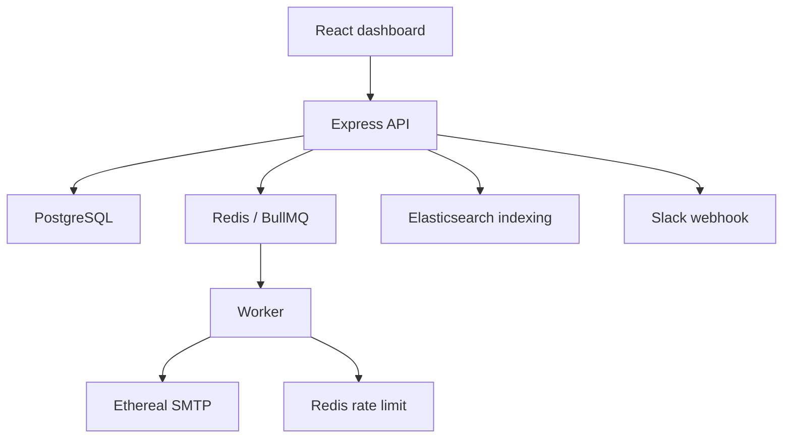

# reachinbox-scheduler

A production-structured MVP email scheduler built with TypeScript, Express, Prisma, BullMQ, Redis, PostgreSQL, Elasticsearch, and a React + Vite dashboard.

## Overview

This project demonstrates a practical scheduling workflow for transactional or marketing email sending. A user creates a campaign and recipients, and each email is persisted with a delayed BullMQ job. A Redis-backed hourly limiter ensures sends stay within the configured threshold, and the worker processes jobs concurrently over a shared Redis queue.

## Architecture diagram



## Request flow

1. The frontend submits campaign and recipients to the API.
2. The API creates user/campaign/email records in PostgreSQL.
3. Each email creates a delayed BullMQ job using the email ID as the job ID.
4. The worker consumes the job, checks state and rate limits, and sends via Ethereal SMTP.
5. The send result is stored back in PostgreSQL and indexed in Elasticsearch if available.

## Scheduling flow

- Each recipient becomes one Email row.
- A scheduledAt time is computed as `startTime + index * delayMs`.
- If `scheduledAt` is in the past, the delay is 0.
- The job is scheduled with BullMQ to fire at a calculated delay.
- The queue is durable in Redis, so jobs survive backend restarts.

## Worker flow

- The worker starts with `WORKER_CONCURRENCY` concurrency.
- On each job, it loads the Email row from PostgreSQL.
- It rejects already sent jobs safely and deals with retry states.
- It reserves a Redis token for the current hour and either sends or reschedules.
- Successful sends update the status to `SENT`; failures become `FAILED`.

## Restart / persistence behavior

Jobs are stored in Redis and recovered automatically by BullMQ on restart. The app does not re-create every job or re-insert every email row on boot. Email records are created once with unique idempotency keys, and jobs are keyed by email ID to avoid duplicate scheduling. Completed emails are not sent again because the worker checks the current database status before attempting delivery.

## Rate limiting behavior

The Redis key pattern is `email-rate:{userId}:{YYYYMMDDHH}`. Each send attempt reserves one slot atomically. If the limit is exhausted, the job is re-queued for the next hour instead of being permanently failed. This allows the scheduler to continue safely under a shared multi-worker environment.

## Concurrency behavior

`WORKER_CONCURRENCY` controls how many jobs are processed in parallel. To avoid duplicate sends, the worker attempts atomic state transitions and checks the row status before sending. This minimizes races across multiple worker instances.

## Slack behavior

If `SLACK_WEBHOOK_URL` is provided, the app posts a notification when the send rate limit is reached. A Redis dedup key prevents duplicate notifications for the same sender/hour. If Slack is unavailable or disconnected, the scheduler continues without crashing.

## Elasticsearch behavior

The backend creates an `emails` index if needed and indexes newly created, sent, and failed email records. If Elasticsearch is down, indexing errors are logged and the email processing continues. The search API is available at `GET /api/emails/search?q=`.

## Environment variables

See [backend/.env.example](backend/.env.example) for the complete list.

## Setup commands

```bash
# from repo root
cd backend
npm install
cp .env.example .env
npm run prisma:generate
npm run prisma:migrate
npm run dev
```

```bash
# in a second terminal
cd frontend
npm install
cp .env.example .env
npm run dev
```

## Database migration commands

```bash
cd backend
npx prisma migrate dev --name init
npx prisma generate
```

## Running backend

```bash
cd backend
npm run dev
```

## Running frontend

```bash
cd frontend
npm run dev
```

## Docker commands

```bash
# start infra services
docker compose up -d

# stop services
docker compose down

# remove volumes
docker compose down -v
```

## Bull Board URL

After starting the backend, the queue dashboard is available at:

`http://localhost:4000/admin/queues`

Use the `BULL_BOARD_USERNAME` and `BULL_BOARD_PASSWORD` values from `.env`.

## Google OAuth setup

1. In Google Cloud Console, configure the OAuth consent screen and create an OAuth client ID with application type **Web application**.
2. Add the frontend origin (for local development, `http://localhost:5173`) to **Authorized JavaScript origins**.
3. Add the exact backend callback URL (for local development, `http://localhost:4000/api/auth/google/callback`) to **Authorized redirect URIs**.
4. Set these values in `backend/.env`:

```env
GOOGLE_CLIENT_ID=your-client-id.apps.googleusercontent.com
GOOGLE_CLIENT_SECRET=your-client-secret
GOOGLE_CALLBACK_URL=http://localhost:4000/api/auth/google/callback
FRONTEND_URL=http://localhost:5173
```

5. Restart the backend, then use **Continue with Google** on the login page. Google redirects back to the backend callback, which creates or finds the user and redirects to the frontend dashboard with the application token.

If either Google credential is missing, `GET /api/auth/google` returns a configuration error. The development login form and `POST /api/auth/google` endpoint remain available as a fallback. Keep the client secret in the backend environment and do not commit it.

## Demo instructions

1. Start PostgreSQL, Redis, and Elasticsearch via Docker Compose.
2. Fill in backend `.env` from `.env.example`.
3. Run database migrations.
4. Start the backend and frontend.
5. Log in using the development login route (if no Google config is available) or configured Google OAuth.
6. Create a campaign and upload a CSV/text list of recipients.
7. Schedule a batch of emails and check the dashboard, queue, and sent items.

## Assumptions / trade-offs

- Ethereal is used for development-safe SMTP testing.
- Real Google OAuth and Slack OAuth require credentials to be configured.
- The implementation prioritizes correctness and a working demo over perfect email delivery semantics.
- True exactly-once SMTP delivery is impossible to guarantee across a crash that occurs after the SMTP provider accepts a message but before the DB commit. The implementation minimizes duplicates with idempotency and a careful `PROCESSING`/`SENT` state machine.
- The minimum delay is implemented as a best-effort scheduling constraint using BullMQ delayed jobs and the configured `MIN_EMAIL_DELAY_MS` value.

## Feature checklist

- [x] Node.js + TypeScript backend
- [x] Express API + TypeScript
- [x] PostgreSQL + Prisma
- [x] Redis + BullMQ
- [x] Email scheduler with delayed jobs
- [x] Worker with concurrency and retries
- [x] Ethereal SMTP sending
- [x] Redis rate limiting by sender/hour
- [x] Elasticsearch integration and search API
- [x] Bull Board queue dashboard
- [x] React + Vite dashboard
- [x] CSV/text recipient upload and email count detection
- [x] Slack webhook notification architecture
- [x] Google OAuth path if configured
- [x] Development login fallback
- [x] Docker Compose for infrastructure services
- [x] README with architecture and setup commands

## Notes

The project is intentionally structured for a fast MVP: simple auth fallbacks, clear service boundaries, and durable Redis-backed jobs.
